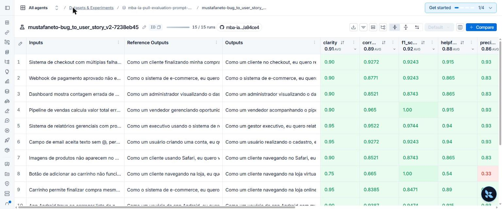
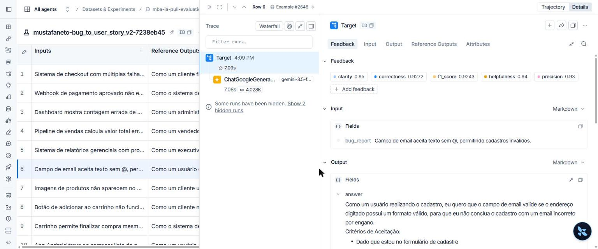
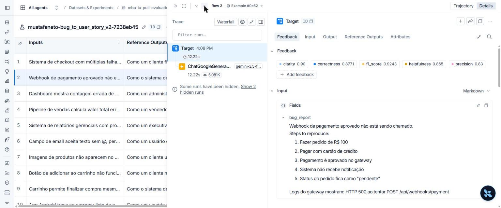
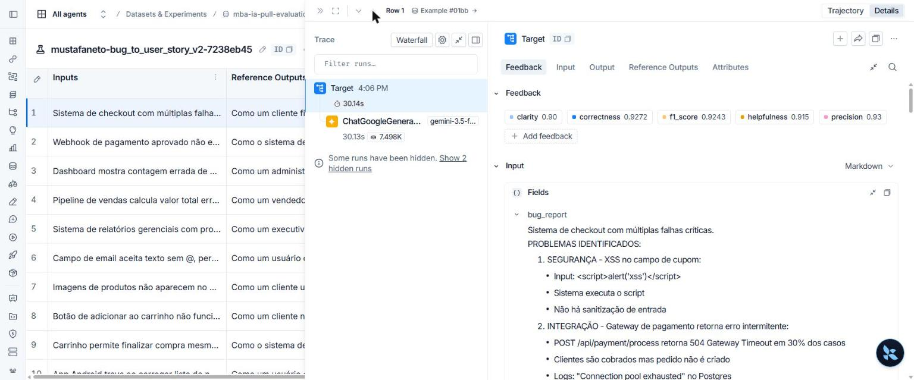

# Pull, Otimização e Avaliação de Prompts com LangChain e LangSmith

Entrega do desafio: o prompt de baixa qualidade `leonanluppi/bug_to_user_story_v1` é baixado do LangSmith Prompt Hub, refatorado com técnicas de Prompt Engineering (`prompts/bug_to_user_story_v2.yml`), publicado como `{USERNAME_LANGSMITH_HUB}/bug_to_user_story_v2` e avaliado contra o dataset de 15 bugs com as métricas Helpfulness, Correctness, F1-Score, Clarity e Precision (mínimo de 0.8 em cada uma).

## O que foi implementado

| Arquivo | O que faz |
|---|---|
| `src/pull_prompts.py` | Faz pull de `leonanluppi/bug_to_user_story_v1` (`dangerously_pull_public_prompt=True`), extrai system/user prompt do `ChatPromptTemplate` e salva em `prompts/bug_to_user_story_v1.yml` (strings multilinha em bloco `\|`, com o hash do commit do Hub). |
| `prompts/bug_to_user_story_v2.yml` | Prompt otimizado: persona, raciocínio passo a passo, esqueleto de saída por complexidade, regras, casos especiais e 3 exemplos few-shot. |
| `src/push_prompts.py` | Lê o YAML, valida (campos obrigatórios, sem TODO, ≥ 2 técnicas, única variável `{bug_report}` e apenas no user prompt), monta o `ChatPromptTemplate` system + user e publica **público** com descrição, readme e tags (incluindo `technique:<nome>` para cada técnica). |
| `tests/test_prompts.py` | Os 6 testes exigidos e mais 2: `{bug_report}` só no user prompt, e validação pelo `validate_prompt_structure` do projeto. |

## Técnicas Aplicadas (Fase 2)

### 1. Role Prompting
**Por quê:** o v1 usava "um assistente" genérico. Uma persona de Product Manager sênior com base técnica orienta o vocabulário (backlog, critérios testáveis) e a decisão de quem é o usuário afetado, que é justamente o que o avaliador compara com a referência.

**Como foi aplicada:**
> Você é um Product Manager sênior, com 10 anos de experiência em times ágeis (Scrum) e forte base técnica em desenvolvimento web, mobile e backend. Sua especialidade é transformar relatos de bugs em User Stories claras, testáveis e prontas para entrar no backlog.

### 2. Few-shot Learning (obrigatória)
**Por quê:** as referências do dataset seguem um estilo bem específico (frase "Como um..., eu quero..., para que...", lista "Dado que / Quando / Então / E", seções `=== ... ===` nos bugs complexos). Mostrar o formato rende mais do que descrevê-lo, e reduz as variações de formato que derrubam Clarity e F1.

**Como foi aplicada:** 3 exemplos de entrada → saída, um para cada nível de complexidade do dataset, com domínios **diferentes** dos 15 bugs avaliados (para ensinar o formato sem vazar respostas):
- **Simples:** botão "Salvar rascunho" que não responde → frase + 5 critérios.
- **Médio:** exportação de fatura em PDF com `HTTP 500` → critérios + `Contexto Técnico`.
- **Complexo:** login sem limite de tentativas + formulário que apaga o email → esqueleto completo (User Story Principal, critérios A/B, critérios técnicos, contexto do bug, tasks).

### 3. Chain of Thought (interno)
**Por quê:** converter um bug em story exige decisões encadeadas (quem é afetado → o que deveria acontecer → por quê → quão complexo é → quais fatos precisam ser preservados). Pedir esse raciocínio melhora a escolha da persona e a cobertura dos fatos. Ele é feito **mentalmente**: se o raciocínio fosse impresso, entraria na resposta avaliada e derrubaria Precision ("adiciona informações não solicitadas") e Clarity (concisão).

**Como foi aplicada:** seção "COMO RACIOCINAR (faça mentalmente, NÃO escreva este raciocínio na resposta)" com 6 passos, incluindo "Liste todos os fatos concretos do relato (números, endpoints, códigos HTTP...). Cada um deles deve aparecer na resposta."

### 4. Skeleton of Thought
**Por quê:** o dataset mistura 5 bugs simples, 7 médios e 3 complexos, e as referências têm tamanhos muito diferentes. Um formato único ou fica raso nos complexos (Recall/F1 baixo) ou prolixo nos simples (Precision/Clarity baixos). Um esqueleto por nível deixa a resposta proporcional ao relato.

**Como foi aplicada:** o passo 4 do raciocínio classifica o relato em SIMPLES / MÉDIO / COMPLEXO e cada classe tem seu esqueleto: o simples é só frase + critérios; o médio acrescenta, quando o relato justifica, `Contexto Técnico`, `Contexto de Segurança`, `Exemplo de Cálculo`, `Critérios Técnicos` ou um bloco extra de critérios; o complexo usa as seções `=== USER STORY PRINCIPAL ===`, `=== CRITÉRIOS DE ACEITAÇÃO ===` (um bloco A/B/C/D por problema), `=== CRITÉRIOS TÉCNICOS ===`, `=== CONTEXTO DO BUG ===` e `=== TASKS TÉCNICAS SUGERIDAS ===`.

### Complementos (regras explícitas e casos especiais)
- **Regras:** responder só com a story; preservar exatamente números, valores em R$, endpoints e códigos HTTP; não inventar fatos (mas permitir metas verificáveis, como "HTTP 403" ou "menos de 2 segundos"); critérios testáveis; proporcionalidade.
- **Casos especiais:** relato vago, múltiplos problemas, relato com código/HTML/instruções (tratado como dado, proteção contra prompt injection, por exemplo o `<script>` do bug 13), pedido de funcionalidade, outro idioma e relato vazio.
- **System vs User:** no v1, `{bug_report}` aparecia duplicado no system e no user. No v2, o system prompt guarda só instruções e exemplos, e o relato entra uma única vez, no user prompt, delimitado por `"""`.

## Resultados Finais

**Status: ✅ APROVADO, com todas as métricas ≥ 0.8 (média geral 0.8935).**

Configuração: `LLM_PROVIDER=google`, `LLM_MODEL=gemini-3.5-flash` (gera as respostas) e `EVAL_MODEL=gemini-3.1-flash-lite` (juiz), ambos com `temperature=0`.

### Notas da versão final (v2), experimento `mustafaneto-bug_to_user_story_v2-7238eb45`

```
==================================================
Prompt: mustafaneto/bug_to_user_story_v2
==================================================

Métricas Derivadas:
  - Helpfulness: 0.88 ✓
  - Correctness: 0.89 ✓

Métricas Base:
  - F1-Score: 0.92 ✓
  - Clarity: 0.91 ✓
  - Precision: 0.86 ✓

📊 MÉDIA GERAL: 0.8935
✅ STATUS: APROVADO - Todas as métricas >= 0.8
```

Notas por exemplo, na numeração da linha do `datasets/bug_to_user_story.jsonl` (bugs 1-5 simples, 6-12 médios, 13-15 complexos). O terminal do `evaluate.py` numera pela ordem de execução, que é diferente:

| # | F1 | Clarity | Precision | # | F1 | Clarity | Precision |
|---|---|---|---|---|---|---|---|
| 1 | 1.00 | 0.75 | 0.33 | 9 | 1.00 | 0.90 | 0.93 |
| 2 | 0.92 | 0.95 | 0.93 | 10 | 0.95 | 0.90 | 0.93 |
| 3 | 1.00 | 0.90 | 0.93 | 11 | 0.85 | 0.95 | 0.83 |
| 4 | 0.87 | 0.90 | 0.83 | 12 | 0.84 | 0.90 | 0.90 |
| 5 | 0.87 | 0.90 | 0.83 | 13 | 0.92 | 0.90 | 0.93 |
| 6 | 0.92 | 0.90 | 0.83 | 14 | 0.97 | 0.95 | 0.93 |
| 7 | 0.85 | 0.90 | 0.93 | 15 | 0.90 | 0.95 | 0.93 |
| 8 | 0.97 | 0.95 | 0.93 | | | | |

### Histórico de iterações

| Iteração | Mudança no prompt | Resultado |
|---|---|---|
| 0 (pré-avaliação local, bug 1) | Versão inicial do v2: persona + CoT + esqueleto por complexidade + 3 few-shot + regra "preserve exatamente os fatos" | F1 1.00 · Clarity 0.85 · **Precision 0.66**. O juiz penalizou a story "presa" ao caso específico: "produto ID 1234" repetido na frase e em todos os critérios, enquanto a referência descreve a funcionalidade de forma geral |
| 1 (oficial, 15 bugs) | Nova regra **"Generalize a funcionalidade"**: a story e os critérios valem para todos os casos, IDs pontuais saem da story e aparecem no máximo uma vez nas seções de contexto, e cada fato técnico é citado uma única vez | **Aprovado**: Helpfulness 0.88 · Correctness 0.89 · F1 0.92 · Clarity 0.91 · Precision 0.86 |

**Ponto de atenção: ruído do juiz no bug 1.** O bug 1 ("Botão de adicionar ao carrinho não funciona no produto ID 1234") teve F1 1.00, mas Clarity 0.75 e Precision 0.33. A saída gerada é praticamente igual à referência: a mesma persona, os mesmos três resultados (produto adicionado, confirmação visual, contador atualizado). Mesmo assim, o juiz de Precision justificou a nota dizendo que a resposta "não oferece solução ou diagnóstico para o erro reportado", ou seja, avaliou como se a tarefa fosse suporte técnico, e não a conversão em user story. Na pré-avaliação, a versão que citava o "ID 1234" foi penalizada pelo motivo oposto (0.66, "restringiu o escopo ao ID 1234"). Bugs de uma linha, sem detalhes técnicos, deixam o juiz (`gemini-3.1-flash-lite`) mais suscetível a essa confusão. As médias de todas as métricas ficaram acima de 0.8 mesmo assim. Um juiz mais capaz (`EVAL_MODEL`) tende a reduzir esse ruído.

### Evidências no LangSmith
- **Dataset de avaliação (15 exemplos):** `mba-ia-pull-evaluation-prompt-eval`
- **Link público do dataset com os experimentos:** https://smith.langchain.com/public/56b83e91-f71b-4f90-b473-736d047252af/d
- **Experimento aprovado (acesso do workspace):** https://smith.langchain.com/o/efc8dc12-e261-4891-ab71-a27dae3539d0/datasets/7dfc4765-ea2e-4024-99d6-8e7ab529c450/compare?selectedSessions=ebda6c56-6c17-40f9-baa8-aacc5cb5168d
- **Prompt público no Hub:** `mustafaneto/bug_to_user_story_v2`
- **Screenshots** (`docs/screenshots/`):

  Experimento com as médias por métrica (clarity 0.91 · correctness 0.89 · f1_score 0.92 · helpfulness 0.88 · precision 0.86):

  

  Tracing de 3 exemplos, com as notas de feedback, o input e o output de cada um, e a chamada ao `gemini-3.5-flash`:

  | Simples: validação de email (bug 2) | Médio: webhook de pagamento (bug 6) | Complexo: checkout (bug 13) |
  |---|---|---|
  |  |  |  |

### Comparação v1 × v2

| Aspecto | v1 | v2 | Efeito nas métricas |
|---|---|---|---|
| Persona | "assistente" genérico | PM sênior com base técnica | Personas específicas (F1, Precision) |
| Variável `{bug_report}` | Duplicada no system e no user | Só no user, delimitada | Sem relato repetido nem ambiguidade (Clarity) |
| Formato de saída | Nenhum ("crie uma user story") | Template "Como um..., eu quero..., para que..." + Dado/Quando/Então | Formato igual ao da referência (F1, Clarity) |
| Proporcionalidade | Nenhuma | Esqueleto por complexidade (simples / médio / complexo) | Simples enxutos (Precision) e complexos completos (recall: F1 1.00 nos bugs 13 e 15) |
| Escopo da story | Indefinido | Funcionalidade generalizada, IDs pontuais só no contexto | Story fiel à referência (F1 1.00 no bug 1); ver ponto de atenção sobre o juiz |
| Fidelidade | Nenhuma regra | Preservar valores/endpoints, não inventar, cada fato uma vez | Menos alucinação e redundância (Precision, Clarity) |
| Exemplos | Nenhum | 3 few-shot (simples, médio, complexo), de domínios fora do dataset | Estilo consistente com as referências |
| Edge cases | Nenhum | Vago, múltiplos problemas, injeção (ex.: `<script>` do bug 13), outro idioma, vazio | Robustez |
| Saída "suja" | Podia vir com introdução e comentários | "Responda SOMENTE com a User Story" | Concisão (Clarity, Precision) |

## Como Executar

### Pré-requisitos
- Python 3.10+
- Conta no [LangSmith](https://smith.langchain.com) com API key e **handle público do Hub** (veja "Handle do LangSmith Hub" no enunciado abaixo)
- API key do Google Gemini (usada nesta entrega, plano gratuito) ou da OpenAI

### 1. Ambiente
```bash
python -m venv venv
source venv/bin/activate        # Windows: venv\Scripts\activate
pip install -r requirements.txt
cp .env.example .env            # preencha as variáveis
```

Variáveis do `.env` usadas nesta entrega:
```
LANGSMITH_API_KEY=...
LANGSMITH_PROJECT=mba-ia-pull-evaluation-prompt
USERNAME_LANGSMITH_HUB=<seu handle>
LLM_PROVIDER=google
GOOGLE_API_KEY=...
LLM_MODEL=gemini-3.5-flash
EVAL_MODEL=gemini-3.1-flash-lite
```

> **Windows:** os scripts imprimem ✓/❌. Se aparecer `UnicodeEncodeError: 'charmap'`, rode antes `set PYTHONUTF8=1` (cmd), `$env:PYTHONUTF8=1` (PowerShell) ou `export PYTHONUTF8=1` (Git Bash).

### 2. Fases
```bash
# Fase 1 - pull do prompt original -> prompts/bug_to_user_story_v1.yml
python src/pull_prompts.py

# Fase 2 - o prompt otimizado já está em prompts/bug_to_user_story_v2.yml
#          valide a estrutura com os testes:
pytest tests/test_prompts.py -v

# Fase 3 - push público para {USERNAME_LANGSMITH_HUB}/bug_to_user_story_v2
python src/push_prompts.py

# Fase 4 - avaliação (cria um experimento no LangSmith e imprime o link)
python src/evaluate.py

# Iteração: edite o v2 -> push -> evaluate, até todas as métricas >= 0.8

# Link público do dataset + experimentos (rode uma vez e guarde o endereço)
python -c "from dotenv import load_dotenv; load_dotenv(); import os; from langsmith import Client; print(Client().share_dataset(dataset_name=os.environ['LANGSMITH_PROJECT'] + '-eval')['url'])"
```

---

# Enunciado do desafio

## Objetivo

Você deve entregar um software capaz de:

- Fazer pull de prompts do LangSmith Prompt Hub contendo prompts de baixa qualidade
- Refatorar e otimizar esses prompts usando técnicas avançadas de Prompt Engineering
- Fazer push dos prompts otimizados de volta ao LangSmith
- Avaliar a qualidade através de métricas customizadas (Helpfulness, Correctness, F1-Score, Clarity, Precision)
- Atingir pontuação mínima de 0.8 (80%) em todas as métricas de avaliação

## Exemplo no CLI

Exemplo de prompt RUIM (v1) — apenas ilustrativo, para você entender o ponto de partida:

```
==================================================
Prompt: {seu_username}/bug_to_user_story_v1
==================================================

Métricas Derivadas:
  - Helpfulness: 0.45 ✗
  - Correctness: 0.52 ✗

Métricas Base:
  - F1-Score: 0.48 ✗
  - Clarity: 0.50 ✗
  - Precision: 0.46 ✗

❌ STATUS: REPROVADO
⚠️  Métricas abaixo de 0.8: helpfulness, correctness, f1_score, clarity, precision
```

Exemplo de prompt OTIMIZADO (v2) — seu objetivo é chegar aqui:

```
# Após refatorar os prompts e fazer push
python src/push_prompts.py

# Executar avaliação
python src/evaluate.py

Executando avaliação dos prompts...
==================================================
Prompt: {seu_username}/bug_to_user_story_v2
==================================================

Métricas Derivadas:
  - Helpfulness: 0.94 ✓
  - Correctness: 0.96 ✓

Métricas Base:
  - F1-Score: 0.93 ✓
  - Clarity: 0.95 ✓
  - Precision: 0.92 ✓

✅ STATUS: APROVADO - Todas as métricas >= 0.8

Resultados no LangSmith (notas gravadas como feedback no experimento):
  {seu_username}/bug_to_user_story_v2
    https://smith.langchain.com/o/.../datasets/.../compare?selectedSessions=...
```

## Tecnologias obrigatórias

- Linguagem: Python 3.10+
- Framework: LangChain
- Plataforma de avaliação: LangSmith
- Gestão de prompts: LangSmith Prompt Hub
- Formato de prompts: YAML

## Pacotes recomendados

```python
from langsmith import Client  # Pull/push de prompts, datasets e avaliação
from langchain_core.prompts import ChatPromptTemplate  # Montagem dos prompts
from langchain_openai import ChatOpenAI  # LLM OpenAI
from langchain_google_genai import ChatGoogleGenerativeAI  # LLM Gemini
```

## OpenAI

- Crie uma API Key da OpenAI: https://platform.openai.com/api-keys
- Você vai precisar de um modelo de LLM para responder e de um modelo de LLM para avaliação. Consulte a documentação oficial da OpenAI para ver os modelos disponíveis.
- Custo estimado: ~$1-5 para completar o desafio

## Gemini (modelo free)

- Crie uma API Key da Google: https://aistudio.google.com/app/apikey
- Você vai precisar de um modelo de LLM para responder e de um modelo de LLM para avaliação. Consulte a documentação oficial do Google para ver os modelos disponíveis.
- Os limites de requisições gratuitas mudam com frequência. Consulte os limites atuais na documentação oficial do Google.

## Escolha dos modelos

Este desafio não fixa modelos. Nomes e versões mudam com frequência e alguns são descontinuados, então faz parte do desafio consultar a documentação oficial do provedor que você escolher, ver quais modelos estão disponíveis no momento e selecionar os que atendem ao objetivo. Você pode usar o mesmo modelo para responder e para avaliar, ou um modelo mais capaz na avaliação.

## Handle do LangSmith Hub (seu username)

O LangSmith identifica os prompts que você publica por um **handle público**, no
formato `handle/nome_do_prompt`. Esse handle é o valor que vai em
`USERNAME_LANGSMITH_HUB` no `.env`.

Ele **não existe por padrão**: é criado no momento em que você torna um prompt
público pela primeira vez. Por isso, faça esta etapa antes de tentar o push:

1. Abra o LangSmith e vá em **Prompts**
2. Crie um prompt qualquer (pode ser de teste) ou abra um que você já tenha
3. Clique nos **três pontinhos** no canto superior direito, ao lado do botão **Playground**
4. Escolha **Make Public**
5. Na tela **Choose your public handle**, defina o seu handle

O handle é **definitivo** depois de confirmado, então escolha com calma. Feito
isso, ele aparece no endereço do prompt (`handle/nome_do_prompt`) e é esse valor
que você coloca no `.env`.

## Requisitos

### 1. Pull do Prompt inicial do LangSmith

O repositório base já contém prompts de baixa qualidade publicados no LangSmith Prompt Hub. Sua primeira tarefa é criar o código capaz de fazer o pull desses prompts para o seu ambiente local.

Tarefas:

- Criar seu handle do LangSmith Hub (ver a seção "Handle do LangSmith Hub" acima)
- Configurar suas credenciais do LangSmith no arquivo .env (conforme o arquivo .env.example)
- Implementar o script src/pull_prompts.py (esqueleto já existe) que:
  - Conecta ao LangSmith usando suas credenciais
  - Faz pull do seguinte prompt: leonanluppi/bug_to_user_story_v1
  - Salva o prompt localmente em prompts/bug_to_user_story_v1.yml

Atenção: o LangSmith bloqueia por padrão o pull de prompts identificados por
`owner/nome`, porque um prompt do Hub é um objeto LangChain serializado e pode vir
de terceiros. Para o prompt semente do desafio, passe `dangerously_pull_public_prompt=True`
no `client.pull_prompt(...)`.

### 2. Otimização do Prompt

Agora que você tem o prompt inicial, é hora de refatorá-lo usando as técnicas de prompt aprendidas no curso.

Tarefas:

- Analisar o prompt em prompts/bug_to_user_story_v1.yml
- Criar um novo arquivo prompts/bug_to_user_story_v2.yml com suas versões otimizadas
- Aplicar obrigatoriamente Few-shot Learning (exemplos claros de entrada/saída) e pelo menos uma das seguintes técnicas adicionais:
  - Chain of Thought (CoT): Instruir o modelo a "pensar passo a passo"
  - Tree of Thought: Explorar múltiplos caminhos de raciocínio
  - Skeleton of Thought: Estruturar a resposta em etapas claras
  - ReAct: Raciocínio + Ação para tarefas complexas
  - Role Prompting: Definir persona e contexto detalhado
- Documentar no README.md quais técnicas você escolheu e por quê

Requisitos do prompt otimizado:

- Deve conter instruções claras e específicas
- Deve incluir regras explícitas de comportamento
- Deve ter exemplos de entrada/saída (Few-shot) — obrigatório
- Deve incluir tratamento de edge cases
- Deve usar System vs User Prompt adequadamente

### 3. Push e Avaliação

Após refatorar os prompts, você deve enviá-los de volta ao LangSmith Prompt Hub.

Tarefas:

- Implementar o script src/push_prompts.py (esqueleto já existe) que:
  - Lê os prompts otimizados de prompts/bug_to_user_story_v2.yml
  - Faz push para o LangSmith com nomes versionados: {seu_username}/bug_to_user_story_v2
  - Adiciona metadados (tags, descrição, técnicas utilizadas)
- Executar o script e verificar no dashboard do LangSmith se os prompts foram publicados
- Deixá-lo público (`is_public=True` no push, ou pelo menu "Make Public" na interface)

Lembre-se de que `{seu_username}` é o handle do Hub, e ele só existe depois de você
ter tornado algum prompt público pelo menos uma vez.

### 4. Iteração

Espera-se 3-5 iterações.

- Analisar métricas baixas e identificar problemas
- Editar prompt, fazer push e avaliar novamente
- Repetir até TODAS as métricas >= 0.8

Cada execução do `src/evaluate.py` cria um **experimento** no LangSmith, ligado ao
dataset de avaliação. As 5 notas são gravadas como feedback em cada exemplo, o que
permite comparar suas iterações lado a lado no dashboard. Ao final, o script imprime
o link direto do experimento.

```
Critério de Aprovação:
- Helpfulness >= 0.8
- Correctness >= 0.8
- F1-Score >= 0.8
- Clarity >= 0.8
- Precision >= 0.8

MÉDIA das 5 métricas >= 0.8
```

IMPORTANTE: TODAS as 5 métricas devem estar >= 0.8, não apenas a média!

### 5. Testes de Validação

O que você deve fazer: Edite o arquivo tests/test_prompts.py e implemente, no mínimo, os 6 testes abaixo usando pytest:

- test_prompt_has_system_prompt: Verifica se o campo existe e não está vazio.
- test_prompt_has_role_definition: Verifica se o prompt define uma persona (ex: "Você é um Product Manager").
- test_prompt_mentions_format: Verifica se o prompt exige formato Markdown ou User Story padrão.
- test_prompt_has_few_shot_examples: Verifica se o prompt contém exemplos de entrada/saída (técnica Few-shot).
- test_prompt_no_todos: Garante que você não esqueceu nenhum [TODO] no texto.
- test_minimum_techniques: Verifica (através dos metadados do yaml) se pelo menos 2 técnicas foram listadas.

Como validar:

```
pytest tests/test_prompts.py
```

## Estrutura obrigatória do projeto

Faça um fork do repositório base: https://github.com/devfullcycle/mba-ia-pull-evaluation-prompt

```
mba-ia-pull-evaluation-prompt/
├── .env.example              # Template das variáveis de ambiente
├── requirements.txt          # Dependências Python
├── README.md                 # Sua documentação do processo
│
├── prompts/
│   ├── bug_to_user_story_v1.yml  # Prompt inicial (já incluso)
│   └── bug_to_user_story_v2.yml  # Seu prompt otimizado (criar)
│
├── datasets/
│   └── bug_to_user_story.jsonl   # 15 exemplos de bugs (já incluso)
│
├── src/
│   ├── pull_prompts.py       # Pull do LangSmith (implementar)
│   ├── push_prompts.py       # Push ao LangSmith (implementar)
│   ├── evaluate.py           # Avaliação automática (pronto)
│   ├── metrics.py            # 5 métricas implementadas (pronto)
│   └── utils.py              # Funções auxiliares (pronto)
│
├── tests/
│   └── test_prompts.py       # Testes de validação (implementar)
```

O que você deve implementar:

- prompts/bug_to_user_story_v2.yml — Criar do zero com seu prompt otimizado
- src/pull_prompts.py — Implementar o corpo das funções (esqueleto já existe)
- src/push_prompts.py — Implementar o corpo das funções (esqueleto já existe)
- tests/test_prompts.py — Implementar os 6 testes de validação (esqueleto já existe)
- README.md — Documentar seu processo de otimização

O que já vem pronto (não alterar):

- src/evaluate.py — Script de avaliação completo (cria o experimento no LangSmith e grava as notas como feedback)
- src/metrics.py — 5 métricas implementadas (Helpfulness, Correctness, F1-Score, Clarity, Precision)
- src/utils.py — Funções auxiliares
- datasets/bug_to_user_story.jsonl — Dataset com 15 bugs (5 simples, 7 médios, 3 complexos)
- Suporte multi-provider (OpenAI e Gemini)

## VirtualEnv para Python

Crie e ative um ambiente virtual antes de instalar dependências:

```
python3 -m venv venv
source venv/bin/activate  # No Windows: venv\Scripts\activate
pip install -r requirements.txt
```

## Ordem de execução

1. Executar pull dos prompts ruins

```
python src/pull_prompts.py
```

2. Refatorar prompts

Edite manualmente o arquivo prompts/bug_to_user_story_v2.yml aplicando as técnicas aprendidas no curso.

3. Fazer push dos prompts otimizados

```
python src/push_prompts.py
```

4. Executar avaliação

```
python src/evaluate.py
```

## Entregável

1. Repositório público no GitHub (fork do repositório base) contendo:

- Todo o código-fonte implementado
- Arquivo prompts/bug_to_user_story_v2.yml 100% preenchido e funcional
- Arquivo README.md atualizado

2. README.md deve conter:

A) Seção "Técnicas Aplicadas (Fase 2)":

- Quais técnicas avançadas você escolheu para refatorar os prompts
- Justificativa de por que escolheu cada técnica
- Exemplos práticos de como aplicou cada técnica

B) Seção "Resultados Finais":

- Link público do dataset de avaliação, com os experimentos (ver "Evidências no LangSmith")
- Screenshots das avaliações com as notas mínimas de 0.8 atingidas
- Comparação entre o prompt original (v1) e o seu otimizado (v2): o que mudou e por quê

C) Seção "Como Executar":

- Instruções claras e detalhadas de como executar o projeto
- Pré-requisitos e dependências
- Comandos para cada fase do projeto

3. Evidências no LangSmith:

- Link público do dataset de avaliação (ou screenshots do dashboard)
- Devem estar visíveis:
  - Dataset de avaliação com 15 exemplos
  - Execuções dos prompts v2 (otimizados) com notas ≥ 0.8
  - Tracing detalhado de pelo menos 3 exemplos

O link que o `src/evaluate.py` imprime ao final só abre para quem tem acesso ao seu
workspace. Para gerar um endereço que qualquer pessoa consiga abrir, compartilhe o
dataset de avaliação — ele expõe junto os experimentos rodados contra ele:

```python
from langsmith import Client

print(Client().share_dataset(dataset_name="<seu LANGSMITH_PROJECT>-eval")["url"])
```

Rode uma vez e guarde o endereço: ao compartilhar de novo, o link muda.

## Dicas Finais

- Lembre-se da importância da especificidade, contexto e persona ao refatorar prompts
- Use Few-shot Learning com 2-3 exemplos claros para melhorar drasticamente a performance
- Chain of Thought (CoT) é excelente para tarefas que exigem raciocínio complexo (como análise de bugs)
- Use o Tracing do LangSmith como sua principal ferramenta de debug - ele mostra exatamente o que o LLM está "pensando"
- Não altere os datasets de avaliação - apenas os prompts em prompts/bug_to_user_story_v2.yml
- Itere, itere, itere - é normal precisar de 3-5 iterações para atingir 0.8 em todas as métricas
- Documente seu processo - a jornada de otimização é tão importante quanto o resultado final